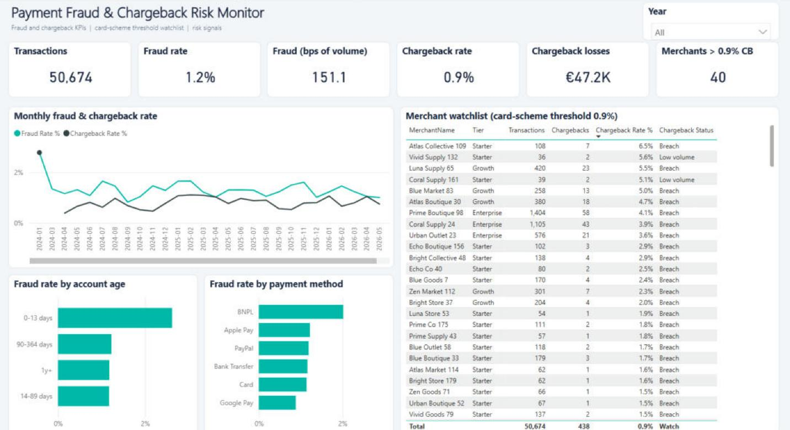
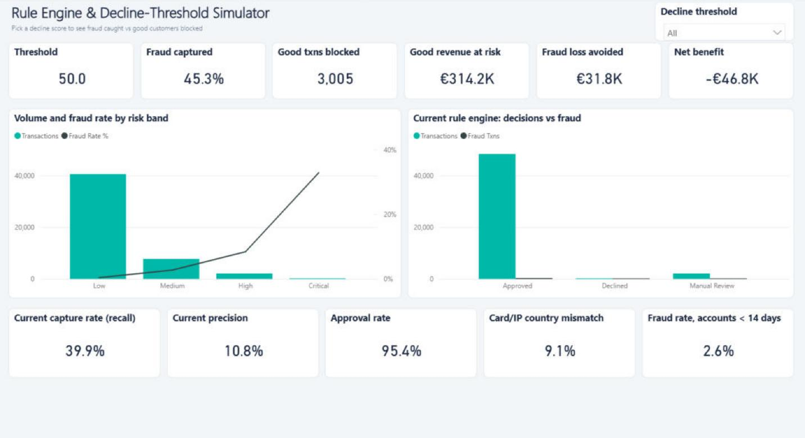

# Payment Fraud & Chargeback Risk Monitor — Power BI

A risk-monitoring dashboard for an e-commerce payments platform: fraud and chargeback rates, merchants breaching card-scheme thresholds, rule-engine precision/recall, and a **what-if decline-threshold simulator** that shows the trade-off between fraud caught and good customers blocked.




## Business questions answered
- What is our fraud rate (count and basis points of volume) and is it spiking today?
- Which merchants are above the 0.9% chargeback-to-transaction ratio that triggers card-scheme monitoring?
- How well does the current rule engine catch fraud, and what would happen if we moved the decline threshold?
- Which signals (geo mismatch, no 3-D Secure, new accounts, unknown devices) carry the most risk?

## Key findings (sample data, 50.7k transactions)
- **Fraud rate 1.2%, chargeback rate 0.9%, €47.2K chargeback losses.**
- **40 of 180 merchants breach the 0.9% chargeback threshold and cause ~62% of all chargebacks** — a short list for the risk team to act on.
- The current rules (review ≥ 55) catch **~40% of fraud** while flagging 4.6% of transactions.
- The simulator shows why you can't just tighten rules: a decline threshold of 50 catches **45% of fraud (€31.8K loss avoided)** but blocks **3,005 good transactions (€314K of revenue)** — a **net loss of €46.8K** once lost margin is counted.
- Card/IP **country mismatch carries ~4.5x the fraud rate** of matching transactions (4.2% vs 0.95%); missing 3-D Secure ~2.8x.

## Data model
```
dim_date ──< fact_transactions >── dim_merchant
   │  (inactive: ChargebackDateKey → dim_date, activated with USERELATIONSHIP)
dim_geography (CardCountry) ──┘
'Decline Threshold' what-if parameter (disconnected)
dim_risk_band (Low / Medium / High / Critical)
```

## What's inside
| Folder | Contents |
|---|---|
| `data/` | Synthetic transaction-level data with risk features, decisions, fraud and chargeback labels |
| `sql/risk_analysis.sql` | Rolling fraud rate, scheme-threshold breach list, confusion matrix, threshold sweep (`GENERATE_SERIES`), signal lift |
| `power-query/fact_transactions.m` | Null handling, typing, engineered features (geo mismatch, account-age band, risk band) |
| `dax/measures.dax` | Fraud/chargeback KPIs, `USERELATIONSHIP` for chargeback-date reporting, precision/recall, what-if simulation, 2σ anomaly flag |
| `Payment-Fraud-Risk-Monitor.pbix` | The Power BI report |
| `*.Report/`, `*.SemanticModel/`, `.pbip` | Power BI Project (PBIR + TMDL) for source control |

## Report pages
1. **Risk Overview** — fraud rate, fraud bps, chargeback rate and losses, monthly trend, fraud rate by account age and payment method, and the merchant watchlist with Breach / Watch / Low volume / OK status.
2. **Rule Engine & Threshold Simulator** — pick a decline score and see fraud captured, good transactions blocked, revenue at risk, loss avoided and net benefit; plus current precision/recall and risk-band mix.

## Skills demonstrated
Power BI · DAX (USERELATIONSHIP, what-if parameters, statistical anomaly detection) · Power Query · risk & fraud reporting · T-SQL

## How to run
Open the `.pbix`, set the `DataFolder` parameter to your local `data\` path, refresh.

*Data is synthetic and generated with Python for portfolio purposes.*
